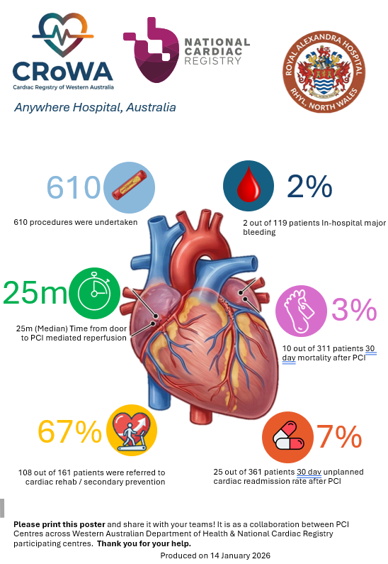
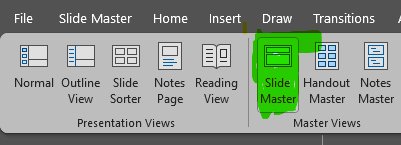
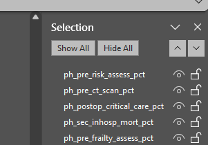
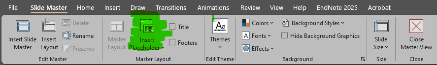

# Cardiac Registry of Western Australia (CRoWA) PCI Posters

Automated generation of hospital-specific quality improvement posters for Percutaneous Intervention (PCI) in the Cardiac Registry of Western Australia, maintained by the Healthcare Quality Intelligence Unit (HQIU). This code can also be applied to the standard National Cardiac Registry submissions for PCI.

## Overview

This project processes raw PCI data and generates PowerPoint posters for each hospital, visualizing key clinical quality indicators (NCR1-NCR11) such as "Door-to-Device Time", "Cardiac Rehab", and "DAPT Prescription Rates".

It uses a **Two-Stage Pipeline**:

1.  **Data Processing** (`prepare_pci_data` from the `utilities.R` file): Cleans raw data, applies strict clinical rules (e.g., STEMI logic), and acts as the "Source of Truth".
2.  **Poster Generation** (`poster_generator.R`): Visualizes the processed summary data into PowerPoint slides.

## Sample Output

The poster template displays quality indicators prominently with colour-coded percentage values:

{width="296"}

------------------------------------------------------------------------

## 1. Quick Start

### Prerequisites

- R (Version 4.0+)
- Required R Packages are loaded via `renv`

### Step 1: Open .Rproj file in RStudio

Navigate to the folder where you have cloned the Git repository, and open the `PCI-Reports.Rproj` file. Your working directory will be automatically set to the root folder of the `.Rproj` file. If it is not, please run the following command, replacing the directory path with your local path.

``` r
setwd("C:/GitHub/PCI-Reports")
```

### Step 2: Open the parent file in the root directory

Open the `generate_pci_reports.R` script from the root folder in your RStudio IDE.

### Step 3: Run Data Load and Pre-Processing from `generate_pci_reports.R`

Run the first section of code, "Load Libraries and Data".

### Step 4: Run Poster Generator

Run the third section of the code, making sure that you update the `input_period_start` and `input_period_end` dates to the period for which you want to cover.

------------------------------------------------------------------------

## 2. The PowerPoint Template

The poster uses `poster_template.pptx` as a base template. The template uses **Slide Master** architecture (not the "Normal" view), which allows for consistent placeholder naming and styling. This makes it muh easier to make edits to the poster.

## Making Changes

1.  Open **`poster_template.pptx`** (in the `pci_poster/` folder)
2.  Switch views: **View** \> **Slide Master**
3.  

::: callout-note
Changes made in Slide Master view will apply to all posters generated from this template.
:::

## Identifying Placeholders (Selection Pane)

To see the specific names of your boxes (which the R script needs to target them):

1.  Stay in **Slide Master** view

2.  On the **Home** ribbon, go to **Select** \> **Selection Pane**

3.  A side panel will list every element on the slide::

    

Click on a box in the slide to see it highlighted in the list. The name shown is the `ph_label` or `id` used in R. In the code, we reference each placeholder using the same name, prefixed with `ph_` (short for placeholder).

## Adding New Content

::: callout-warning
**Don't** add a standard "Text Box" from the Insert menu—the automation script cannot easily populate standard text boxes.
:::

**Instead, use:**

- **Slide Master** ribbon \> **Insert Placeholder**
  - Select **Text** for commentary or titles

  - Select **Picture** for logos or maps

    

After drawing the box, rename it in the **Selection Pane** to match the naming convention:

| Placeholder Purpose | Naming Convention        | Example        |
|---------------------|--------------------------|----------------|
| Percentage display  | `ph_<indicator_id>_value`| `ph_NCR4_value`|
| Narrative text      | `ph_<indicator_id>_desc` | `ph_NCR4_desc` |
| Images              | `pic_<indicator_id>`     | `pic_NCR4`     |

::: callout-tip
Use `officer::layout_properties()` in R to double-check available placeholder labels in your template.
:::

------------------------------------------------------------------------

# Placeholder Reference

The script targets specific placeholders on the slide. If these are deleted, the script will skip them gracefully.

## Header and Footer

| R Variable | Placeholder Label | Description |
|------------------------|------------------------|------------------------|
| `hosp_date_range_text` | `ph_hosp_date_range` | Subtitle with hospital name and date range |
| `report_run_date` | `ph_poster_production_date` | Footer timestamp for when the poster was generated |

## NCR Quality Indicators

The following NCR indicators are mapped to poster placeholders:

| Indicator ID | Description | Placeholder (Pct) | Placeholder (Text) |
|--------------|------------------|------------------|------------------|
| `VOL_PCI` | PCI Volume Count | `ph_VOL_PCI_value` | `ph_VOL_PCI_desc` |
| `Q2101` | STEMI % | `ph_Q2101_value` | `ph_Q2101_desc` |
| `NCR2` | Door-to-PCI Time | `ph_NCR2_value` | `ph_NCR2_desc` |
| `Q2100` | Radial Access | `ph_Q2100_value` | `ph_Q2100_desc` |
| `NCR10` | Cardiac Rehab Referral | `ph_NCR10_value` | `ph_NCR10_desc` |
| `NCR11` | DAPT at Discharge | `ph_NCR11_value` | `ph_NCR11_desc` |

## Logo Placeholder

| Placeholder  | `ph_hosp_logo`                                |
|--------------|-----------------------------------------------|
| **Purpose**  | Hospital logo or location map                 |
| **Fallback** | If no logo exists, a map with pin is inserted |

------------------------------------------------------------------------

## 3. Map Generation

The `utilities/map_generator.R` script:

1.  Reads hospital addresses from `reference_files/hospitals.csv`
2.  Geocodes locations using OpenStreetMap (Nominatim)
3.  Caches coordinates in `ncr_geo_cache.csv`
4.  Generates styled PNG maps with:
    -   Grey Australia base map (RACS style)
    -   Blue dots for all participating sites
    -   Custom pin icon for the focal hospital

{width="300"}

------------------------------------------------------------------------

## 4. Contact

**Department**: WA Health, HQIU 

**Author**: [safetyandquality\@health.wa.gov.au](mailto:safetyandquality@health.wa.gov.au)
